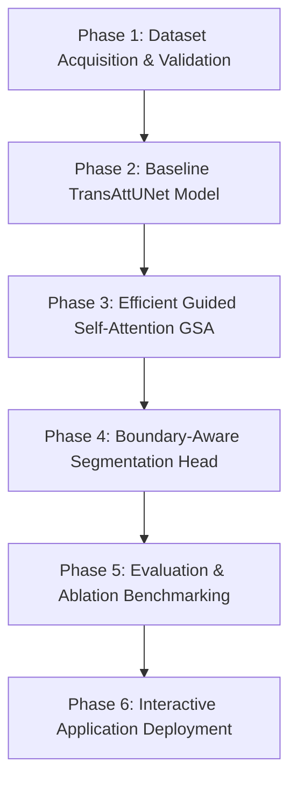

# Experiment Plan: Efficient TransAttUNet for Skin Lesion Segmentation

This document provides the development lifecycle, phased roadmap, and experiment design for the **Efficient TransAttUNet** project on the ISIC 2016 Task 1 Skin Lesion Segmentation benchmark.

---

## 1. Project Roadmap Overview



### Phase Breakdown

1. **Phase 1 — Dataset Acquisition, Preprocessing, and Validation (Completed)**:
   - Official ISIC 2016 Task 1 archive acquisition (900 train, 379 test).
   - Strict identifier-based pairing (`ISIC_XXXXXXX`).
   - Image & mask preprocessing to $256 \times 256$ with bilinear/nearest-neighbor rules.
   - Reproducible 80/20 train/validation split (720 train, 180 val, Seed 42).
   - PyTorch `ISICDataset` and `DataLoader` pipeline.
   - Data-independent segmentation metrics (`Dice`, `IoU`).
   - Automated test suite with synthetic fixtures (`pytest`).

2. **Phase 2 — Baseline TransAttUNet Implementation & Training (Completed)**:
   - Original TransAttUNet architecture with Self-Aware Attention (SAA) bridge (GSA + TSA + Positional Embedding).
   - Multi-scale inter-level decoder skip connections.
   - Combined Soft Dice + Binary Cross-Entropy with Logits loss (`CombinedBCEDiceLoss`).
   - Training engine with AdamW optimizer, cosine annealing scheduler, checkpointing, and metric logging.
   - Single-image inference pipeline producing probability maps, binary masks, and visual overlays (`inference/predict.py`).
   - Automated test coverage across model forward/backward, loss stability, CPU compatibility, and pipeline integration.


3. **Phase 3 — Efficient Guided Self-Attention (GSA) Optimization**:
   - Linear or downsampled attention mechanism to alleviate quadratic complexity $\mathcal{O}(N^2)$.
   - FLOPs, parameter count, and throughput benchmarking against baseline.
   - Latency profiling on CPU and edge targets.

4. **Phase 4 — Boundary-Aware Dual-Head Architecture**:
   - Secondary auxiliary boundary prediction head trained on Sobel / morphological lesion edges.
   - Multi-task boundary-consistency loss.
   - Edge refinement to improve boundary Jaccard index.

5. **Phase 5 — Comprehensive Benchmarking & Comparative Study**:
   - Comparison across: Baseline U-Net, TransAttUNet, Efficient TransAttUNet, Boundary-Aware TransAttUNet.
   - Evaluation on the 379 official ISIC 2016 test images.
   - Generation of qualitative visual comparisons and quantitative metrics tables.

6. **Phase 6 — Clinical Inference Application**:
   - Lightweight interactive web UI (Streamlit / FastAPI / Vanilla UI) for real-time dermoscopic image upload, segmentation overlay, and confidence reporting.

---

## 2. Phase 1 Execution Workflow

Run all commands from the repository root:

```bash
# Step 1: Verify presence of official ISIC archives
python scripts/prepare_dataset.py --check-archives

# Step 2: Download missing archives automatically
python scripts/prepare_dataset.py --download

# Step 3: Extract archives into data/raw/
python scripts/prepare_dataset.py --extract

# Step 4: Preprocess to 256x256 and generate reproducible splits
python scripts/prepare_dataset.py --prepare

# Step 5: Execute comprehensive validation checklist
python scripts/prepare_dataset.py --validate

# Run end-to-end pipeline in one step
python scripts/prepare_dataset.py --all
```

### Running Automated Tests
```bash
python -m pytest tests/ -v
```
All unit tests operate on synthetic in-memory/temp fixtures and execute in under 3 seconds without requiring external dataset downloads.
